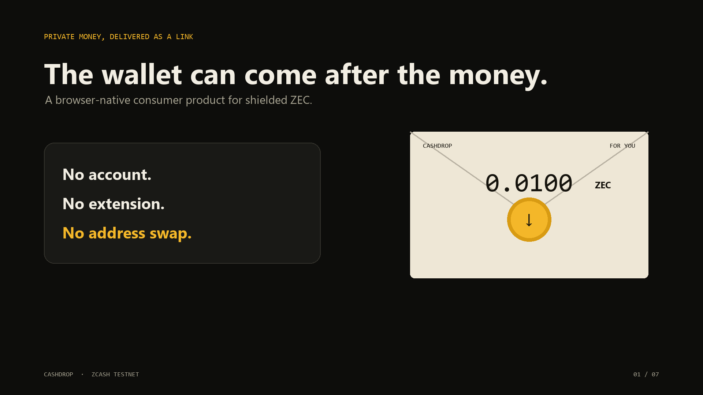

# CashDrop

> Private money, delivered as a link.



[Live app](https://cashdrop-theta.vercel.app/app/?release=4) · [Website](https://cashdrop-theta.vercel.app) · [Demo video](https://cashdrop-theta.vercel.app/demo/cashdrop-demo.mp4) · [Threat model](https://cashdrop-theta.vercel.app/Threat%20Model.dc.html)

CashDrop is a browser-native, non-custodial way to send shielded Zcash before the recipient has a wallet. A sender creates a fresh one-time shielded wallet, funds its address, and shares an encrypted bearer link. The recipient opens that link and sweeps the funds into their own shielded testnet address.

Built for **Zecathon 2026 — Shielded Payments track**.

> **Testnet beta:** CashDrop currently uses Zcash testnet only. Testnet ZEC has no monetary value. Do not use this release with real funds.

## Why it matters

Ordinary crypto payments make the recipient do the work first: install a wallet, back up a seed, find the correct address, and send it to the payer. CashDrop reverses that flow. The money can be waiting before the recipient has a wallet.

Zcash is essential to the design. A public-chain payment link would publish a lasting relationship between the funding wallet, envelope, and recipient. CashDrop keeps both funding and claiming inside Zcash's shielded pool.

## Product modes

CashDrop v3 uses one wax-seal identity across the marketing site, installable PWA, recipient pages, merchant checkout, and recovery flows. The responsive interface switches between a dark sender console and cream recipient paper while retaining the real browser-native wallet engine.

| Mode | Use case | Privacy property |
|---|---|---|
| CashDrop | One private gift, reward, refund, or payment | Optional password; encrypted bearer link |
| DropBatch | Events, community rewards, private payroll, giveaways | A distinct seed and shielded address per recipient |
| Private Fund | Seed funding, community campaigns, general fundraising | Public goal and story; no public donor list or inferred balance |
| CashDrop Checkout | Point of sale for products and services | Exact-price request to a fresh merchant shielded address |
| Private Payment Verification | Merchant confirmation without a public receipt server | Imports the private recovery file, scans testnet locally, and distinguishes confirmed, pending, underpaid, and unpaid requests |
| CashDrop Plans | Weekly, monthly, or yearly subscriptions | Customer-approved renewals with local merchant-side verification; no automatic wallet authority |
| Recover / reclaim | Sender recovery of an unspent envelope | Recovery bundle stays local and never reaches CashDrop |
| Browser wallet | Recipient onboarding without an extension | Seed and address generated locally |

## Working testnet flow

1. Open the [CashDrop web app](https://cashdrop-theta.vercel.app/app/?release=4).
2. Choose **Create a CashDrop**.
3. Enter the amount, note, optional password, and suggested deadline.
4. CashDrop loads WebZjs and derives a fresh Zcash testnet unified address locally.
5. Fund that address with the displayed amount plus the 0.0001 ZEC claim-fee reserve.
6. Save the recovery JSON.
7. Share the complete claim link through an end-to-end encrypted channel. If password protected, send the password separately.
8. The recipient opens the link, enters a shielded testnet destination, and claims.
9. WebZjs scans compact blocks, constructs the transaction and proof locally, and broadcasts to testnet.

## Architecture

```
Sender browser                       Zcash testnet                    Recipient browser
┌────────────────────┐       shielded funding tx       ┌───────────────────────────┐
│ WebZjs WASM wallet │ ───────────────────────────────▶ │ One-time shielded address │
│ Fresh seed/address │                                  └─────────────┬─────────────┘
│ AES-GCM envelope   │                                                │
└─────────┬──────────┘                                                │ encrypted link
          │ encrypted claim link                                      ▼
          └──────────────────────────────────────────────▶ ┌───────────────────────┐
                                                          │ Decrypt locally       │
                                                          │ Scan compact blocks   │
                                                          │ Prove + sweep locally │
                                                          └───────────┬───────────┘
                                                                      │ shielded claim tx
                                                                      ▼
                                                            Recipient shielded wallet
```

CashDrop is a static PWA. There is no CashDrop API, user database, custodial wallet, or analytics pipeline.

### Technology

- **WebZjs / librustzcash WebAssembly** — wallet state, address derivation, scanning, transaction construction, and proving.
- **Zcash testnet lightwallet gateway** — compact block synchronization and transaction broadcast.
- **AES-256-GCM** — claim payload encryption.
- **PBKDF2-SHA-256 (250,000 iterations)** — password-derived keys for locked drops.
- **Web Crypto API** — browser-native cryptography.
- **Service Worker / PWA** — cached browser application.
- **Vercel static hosting** — cross-origin isolation headers required by threaded WebAssembly.

## Privacy model

### Protected

- Funding and claiming remain shielded.
- CashDrop does not receive the seed, claim key, amount, note, or destination address.
- Password-locked links contain ciphertext, IV, salt, and lock marker—but no decryption key.
- Public fundraising links contain campaign metadata and a shielded contribution address, never the organizer seed.
- DropBatch creates independent seeds; compromise of one recipient link does not reveal the rest.

### Honest limits

- The complete unlocked claim link is bearer cash. Anyone holding it may claim first.
- A compromised device or insecure chat can leak a link.
- The remote lightwallet service can observe request timing and network metadata.
- Suggested deadlines are advisory in this beta, not consensus-enforced timelocks.
- Fundraising progress is intentionally not inferred publicly because doing so could weaken privacy.
- WebZjs and CashDrop require independent security review before mainnet use.

See the [full threat model](https://cashdrop-theta.vercel.app/Threat%20Model.dc.html).

## Run locally

The production output is buildless and lives in `dist/`.

```bash
npx serve dist
```

WebZjs uses threaded WebAssembly and requires:

```
Cross-Origin-Opener-Policy: same-origin
Cross-Origin-Embedder-Policy: require-corp
```

For the exact production configuration:

```bash
vercel dev
```

Then open `/app/`.

## Repository map

```
dist/
  index.html                 Product website
  site.css                   Website design system
  app/                       Browser-native CashDrop PWA
  demo/cashdrop-demo.mp4     Narrated 1080p walkthrough
  screenshots/               Submission-ready screenshots
  Threat Model.dc.html       Detailed privacy analysis
  CashDrop Pitch Deck.dc.html
docs/
  DEMO_SCRIPT.md             Video narration and shot list
  SUBMISSION.md              Ready-to-paste hackathon submission
```

## What makes CashDrop different

Basic Zcash payment links describe where a sender should pay. CashDrop creates a funded, one-time shielded envelope that can be handed to a recipient who does not yet have a wallet. It combines recipient onboarding, password-protected bearer links, independent bulk envelopes, private fundraising, private checkout, customer-approved subscriptions, and sender recovery in one browser-native product.

## Verification performed

- Production app and WebAssembly asset return HTTP 200.
- Required COOP/COEP headers are present.
- WebZjs initializes against the public Zcash testnet gateway.
- Fresh `utest…` unified addresses are derived in the browser.
- Password-protected links omit the raw decryption key.
- DropBatch outputs visibly distinct recipient addresses.
- Public fundraiser payloads exclude recovery seeds.
- JavaScript syntax and Git whitespace checks pass.

The final funded transaction should be repeated during judging using fresh testnet ZEC so judges can observe the complete create → fund → claim flow.

## License

MIT © 2026 CashDrop contributors.
